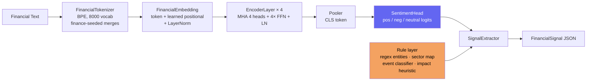

# nano-finbert


[](https://huggingface.co/spaces/9mark9/nano-finbert-demo)

> **🤗 Try it live:** [Financial Sentiment demo on Hugging Face Spaces](https://huggingface.co/spaces/9mark9/nano-finbert-demo) — powered by the production [finbert-minilm-sentiment](https://huggingface.co/9mark9/finbert-minilm-sentiment) model (v2: 96.47% accuracy on its held-out Financial PhraseBank `Sentences_AllAgree` test split).

**The simplest, most readable financial NLP model you can actually understand.**

nano-finbert is a tiny transformer encoder (**1,882,243 parameters**) built **from scratch** on financial text — its own BPE tokenizer, its own multi-head attention, its own training loop, no pretrained weights, no HuggingFace dependency, no black boxes. Inspired by Andrej Karpathy's [nanoGPT](https://github.com/karpathy/nanoGPT), every component is annotated to explain *why* it exists, not just what it does.

Feed it a financial headline. Get back a structured market signal.

```python
from finbert.signals import SignalExtractor

extractor = SignalExtractor.pretrained()  # the checkpoint shipped in this repo
signal = extractor.extract(
    "SpaceX's long-anticipated IPO filing sent aerospace stocks soaring to record highs"
)
print(signal.to_dict())
```

```json
{
  "text": "SpaceX's long-anticipated IPO filing sent aerospace stocks soaring to record highs",
  "sentiment": "neutral",
  "confidence": 0.9811,
  "entities": ["SpaceX"],
  "sectors": ["aerospace", "equities"],
  "event_type": "ipo",
  "impact_score": 0.446,
  "signal_direction": "neutral"
}
```

*Output above is from a real run of this snippet. `SignalExtractor.pretrained()` loads the checkpoint that
ships with this repo (see [Shipped checkpoint](#shipped-checkpoint)), so the result is the same on every run;
that small model reads this headline as neutral. `SignalExtractor()` with
no checkpoint uses randomly initialized weights, so `sentiment`, `confidence`, `impact_score`, and `signal_direction`
vary between runs. `entities`, `sectors`, and `event_type` come from the deterministic rule
layer in `signals.py` and stay stable regardless of model weights. See
[Training](#training) to fit real weights, or use the production model below for a trained
result.*

> **🚀 Two variants — pick what you need:**
>
> | | This repo (`nano-finbert`) | Production model |
> |---|---|---|
> | Goal | *Learn* the internals | *Use* it for real accuracy |
> | Build | From scratch, 1.88M params, annotated | MiniLM (33M) fine-tuned |
> | Accuracy | **Shipped checkpoint (MIT-licensed tweet data): 76.0% held-out test, macro-F1 0.680** ([details](#shipped-checkpoint)). **55.2% held-out test, macro-F1 0.539** (full 3,279-phrase Financial PhraseBank, 15 epochs); **65.4%** with masked-token pretraining plus teacher-labeled news ([distillation](#distillation-experiment)) | **96.47%** (v2, current) on its own test split (the all-annotators-agree subset); **74.3%** on this repo's harder test split (v1; v2 not measured there) |
> | Where | Here, on GitHub | **[🤗 9mark9/finbert-minilm-sentiment](https://huggingface.co/9mark9/finbert-minilm-sentiment)** |
>
> The two headline numbers come from different test sets, so they are not directly comparable. The production model's **96.47% / macro-F1 0.9532** are the v2 numbers in its Hugging Face card's model-index (measured 2026-10-27), from a fine-tuned 33M-param MiniLM evaluated on a stratified 15% test split (340 sentences) of the `Sentences_AllAgree` subset of [Financial PhraseBank](https://huggingface.co/datasets/takala/financial_phrasebank), where every annotator agreed. v2 is trained on PhraseBank plus finance tweets and news headlines; v1 (PhraseBank only, git tag `v1-phrasebank-only` on the model repo) scored **95.29% / 0.937** on the same split. This repo's test split also contains the sentences annotators disagreed on; on that split v1, the revision this repo's distillation scripts pin (`fdbfec0` in `scripts/pins.py`, same weights as the `v1-phrasebank-only` tag), scores **74.3% / macro-F1 0.746** (and some of those sentences may have been in its training data). v2 has not been scored on this split. This repo's **55.2% / macro-F1 0.539** are from training the from-scratch 1.88M-param model in this repo end-to-end (`python scripts/train.py --data-path data/financial_phrasebank.json --epochs 15`) — see [Training](#training) for the full per-class breakdown and what the gap to the production model tells you about model capacity. Use the linked production model when you need real-world accuracy; use this repo to actually understand how a transformer sentiment classifier is built.

---

## Architecture



The blue path (`SentimentHead`) is the **learned** transformer output. The orange
`Rule layer` (`signals.py`) is **deterministic** — regex entity tagging, a sector
keyword map, an event-type classifier, and a 0–1 impact heuristic. The
`SignalExtractor` fuses both into a single `FinancialSignal`. Keeping the
structured-signal logic rule-based (not learned) is deliberate: it stays
inspectable and needs no labelled data for entities/sectors/events.

## Model Architecture

| Component | Spec |
|-----------|------|
| Layers | 4 encoder layers |
| Hidden dim | 128 |
| Attention heads | 4 |
| Max sequence length | 256 tokens |
| Vocabulary size | 8,000 |
| Total parameters | 1,882,243 (embedding 1,057,024 · encoder 791,552 · norm 256 · pooler 16,512 · sentiment head 16,899) |
| Training device | CPU (no GPU needed) |

**Tech stack:** PyTorch 2.x (model + training), a hand-written BPE tokenizer (no `tokenizers`/`transformers` dependency), FastAPI + Uvicorn (serving), pytest (430 test functions across the suite).

## How it works

Each stage maps to one module under `src/finbert/`, kept small and annotated so the
data flow is readable end-to-end:

1. **Tokenize** (`tokenizer.py`) — a from-scratch BPE tokenizer pre-seeded with a
   financial vocabulary (tickers, commodities, FX pairs, M&A/earnings terms) so domain
   tokens survive instead of being shattered into sub-words. Reserved ids: `[PAD]=0`,
   `[UNK]=1`. Target vocab 8,000.
2. **Embed** (`model.py → FinancialEmbedding`) — token embeddings (`padding_idx=0`) plus
   learned positional embeddings, followed by LayerNorm.
3. **Encode** (`model.py`) — 4 Transformer encoder blocks, each: multi-head self-attention
   (4 heads, scaled dot-product, no-bias Q/K/V projections) → residual + LN → position-wise
   FFN with 4× expansion → residual + LN.
4. **Pool + classify** (`model.py → SentimentHead`) — CLS-token pooling into a 3-way
   sentiment head (positive / negative / neutral logits). This is the only **learned**
   prediction in the structured signal.
5. **Extract signal** (`signals.py`) — a deterministic layer turns the sentiment plus the
   raw text into a `FinancialSignal`: regex entity tagging, a sector keyword map, an
   event-type classifier (ipo / earnings / rate_decision / merger / …), an impact heuristic
   (0–1), and a derived bullish/bearish/neutral direction.

Because steps 1–4 are written from scratch (no pretrained weights, no HuggingFace), the
goal is comprehension over accuracy — the production variant above is the one to deploy.

## Quick Start

### Install

```bash
pip install torch --index-url https://download.pytorch.org/whl/cpu
pip install numpy fastapi uvicorn pydantic
git clone https://github.com/shaikn6/nano-finbert
cd nano-finbert
export PYTHONPATH=src
```

### Extract a signal

```python
from finbert.signals import SignalExtractor

extractor = SignalExtractor.pretrained()  # the checkpoint shipped in this repo
# SignalExtractor() with no arguments uses random weights (structural testing only)

# Single signal
signal = extractor.extract("Bitcoin dropped below $60,000 as SEC regulatory pressure mounted")
print(signal)
# FinancialSignal(sentiment=..., direction=..., confidence=..., impact=..., event='commodity_move', sectors=['crypto'], entities=['Bitcoin'])

# Batch extraction
texts = [
    "Gold futures fell 2.3% amid dollar strength and Fed rate hike concerns",
    "NVIDIA quarterly revenue hit $22 billion on AI accelerator demand",
    "ECB held interest rates steady, signaling a data-dependent approach",
]
signals = extractor.extract_batch(texts)
for s in signals:
    print(f"[{s.signal_direction:7s}] [{s.event_type:15s}] {s.text[:60]}")
```

With no checkpoint loaded (plain `SignalExtractor()`), `SentimentHead` uses randomly initialized weights, so
`sentiment`, `confidence`, `impact_score`, and `signal_direction` are meaningless and will
come out differently every run — do not treat any specific values you see here as real
predictions. `entities`, `sectors`, and `event_type` are computed by the deterministic rule
layer in `signals.py` and are stable regardless of model weights. Train a checkpoint first
(next section) for the sentiment fields to mean anything.

### Serve the API

```bash
docker-compose up
# or:
uvicorn finbert.api.server:app --host 0.0.0.0 --port 8000 --reload
```

```bash
curl -X POST http://localhost:8000/extract \
  -H "Content-Type: application/json" \
  -d '{"text": "SpaceX IPO raised $10 billion at a $250 billion valuation"}'
```

### Train from scratch

```bash
python scripts/train.py --epochs 5 --batch-size 32 --checkpoint-dir checkpoints/
```

## Supported Signal Types

| Field | Values |
|-------|--------|
| `sentiment` | `positive`, `negative`, `neutral` |
| `signal_direction` | `bullish`, `bearish`, `neutral` |
| `event_type` | `ipo`, `earnings`, `rate_decision`, `merger`, `commodity_move`, `regulatory`, `layoffs`, `product_launch`, `general` |
| `sectors` | `tech`, `aerospace`, `commodities`, `crypto`, `forex`, `equities`, `fixed_income` |

## Training

nano-finbert uses two datasets:
- `data/samples/financial_phrases.json` — 198 curated phrases, for a fast end-to-end smoke test.
- `data/financial_phrasebank.json` — the full [Financial PhraseBank](https://huggingface.co/datasets/takala/financial_phrasebank), 3,279 examples (679 negative / 1,300 neutral / 1,300 positive). Not included in the repo: the PhraseBank license (CC BY-NC-SA 3.0) does not allow redistributing it, so place your own copy at this path, in the same JSON format as the sample file.

The training loop in `src/finbert/train.py` is heavily annotated to explain every decision. Data is split into **train/val/test (70/15/15)**, not just train/val — the val set is used to pick the best checkpoint, and the test set is never touched until that checkpoint is evaluated once at the end, so the reported numbers are an honest generalization estimate rather than a number the model was indirectly selected to maximize.

**Real results — full dataset, 15 epochs, batch size 16** (`python scripts/train.py --data-path data/financial_phrasebank.json --epochs 15`):

```
Held-out test set results (best checkpoint, never used for training/selection)
class      precision    recall        f1   support
negative       0.631     0.398     0.488       103
neutral        0.550     0.647     0.595       187
positive       0.529     0.542     0.535       203

accuracy: 0.552   macro_f1: 0.539
```

Only the data split is seeded; weight initialisation is not, so a re-run lands within about a point of these figures (a re-run on 2026-10-11 gave accuracy 0.558, macro-F1 0.547).

Training loss drops to ~0.12 while validation loss climbs to ~1.97 by epoch 15 — the 1.88M-param model overfits the 2,295-example training set well before 15 epochs (best val accuracy, 0.607, is hit mid-run, not at the end). That gap, and the roughly 19-point accuracy gap to the 33M-param production model (v1) on this same test split (74.3%), is the real, honest cost of "from scratch, no pretraining" at this parameter count — not a bug to patch, but exactly the kind of result this repo exists to make visible and inspectable.

**Quick smoke test** (5 epochs on the 198-phrase sample set, via the quick-start command above) just verifies the tokenizer/architecture/training loop work end-to-end — it's not a meaningful benchmark on its own.

**Want real-world accuracy?** Use the fine-tuned **[finbert-minilm-sentiment](https://huggingface.co/9mark9/finbert-minilm-sentiment)** variant — MiniLM (33M) fine-tuned on Financial PhraseBank plus finance tweets and news headlines. Its card reports **96.47% accuracy / macro-F1 0.9532** for v2 on its held-out PhraseBank `Sentences_AllAgree` test split (340 sentences); v1, trained on PhraseBank only, scored 95.29% / 0.937 there.

### Shipped checkpoint

`src/finbert/weights/` holds a trained checkpoint (`nano_finbert_tfns.pt`, 7.6 MB), the tokenizer it was trained with (`tokenizer.json`) and the full run record (`metrics.json`). `SignalExtractor.pretrained()` loads them, and the API and `scripts/infer.py` use them when no `MODEL_PATH` / `--model` is given, so `/health` reports `"trained": true` out of the box.

It is the same 1.88M-parameter architecture trained from scratch on [zeroshot/twitter-financial-news-sentiment](https://huggingface.co/datasets/zeroshot/twitter-financial-news-sentiment) (**MIT** per the dataset card; pinned to revision `ccbe24d`, not redistributed here; only the weights are committed). Labels: bearish to negative, bullish to positive, neutral to neutral. Links (`t.co`) are stripped and exact-duplicate texts removed.

Reproduce: `PYTHONPATH=src python scripts/train_tfns.py --class-weights --dropout 0.3 --weight-decay 0.05` (needs `huggingface_hub` and `scikit-learn` for the download and the baseline; about 4 minutes on a laptop CPU).

- **Split:** train 8,489 / validation 944 (stratified 90/10 of the dataset's train file, seed 42) / test 2,345 (the dataset's own validation file, minus 32 duplicate or overlapping texts). The BPE tokenizer is built on train text only. The test split was scored once, after the checkpoint was fixed.
- **Training:** 10 epochs, batch size 32, AdamW at 3e-4, dropout 0.3, weight decay 0.05, inverse-frequency class weights, sequences truncated to 64 tokens. The epoch with the best validation macro-F1 was kept (epoch 8). Hyperparameters were compared on validation only, across four runs: an unweighted run (it never predicted "negative", validation macro-F1 0.461), and three class-weighted variants (dropout 0.1; dropout 0.3 with weight decay 0.05; dropout 0.2 with learning rate 1e-3 for 8 epochs). Validation macro-F1 was 0.700, 0.711 and 0.584 for the three variants; the second is the shipped one.

Held-out test results (2,345 tweets; class balance 1,534 neutral / 473 positive / 338 negative):

```
class      precision    recall        f1   support
negative       0.540     0.580     0.559       338
neutral        0.864     0.834     0.849      1534
positive       0.614     0.649     0.631       473

accuracy: 0.760   macro_f1: 0.680
```

| Model (same train and test split) | Accuracy | Macro-F1 |
|---|---|---|
| Always predict "neutral" | 0.654 | 0.264 |
| **nano-finbert, shipped checkpoint** | **0.760** | **0.680** |
| TF-IDF (1-2 grams) + logistic regression | 0.828 | 0.753 |

The from-scratch transformer is clearly better than the majority class but worse than the bag-of-words baseline on this data: with about 8,500 training tweets and no pretraining, 1.88M parameters overfit (training loss keeps falling while validation loss rises from epoch 4). With 2,345 test tweets a single accuracy figure has a standard error of about 0.9 points, and this is one seed, so differences of a point or two are not meaningful. These are tweets: the model has not been evaluated on news headlines or filings, and the 55.2% PhraseBank figures above are a different, harder test set and are not comparable. It is also trained on 64-token inputs, so very long texts will degrade.

### Evaluating the sentiment head

Sentiment is the only learned output, so it is the only one that can be scored against labels. `data/eval/headlines_sentiment.json` holds 90 hand-written headlines (30 positive, 30 negative, 30 neutral) that are in neither the training data nor `data/samples/`, written before the checkpoint was scored on them and not edited afterwards. Run:

```bash
PYTHONPATH=src python scripts/eval_sentiment.py
```

```
90 examples from data/eval/headlines_sentiment.json

class      precision    recall        f1   support
negative       0.645     0.667     0.656        30
neutral        0.667     0.800     0.727        30
positive       0.739     0.567     0.642        30

accuracy: 0.678   macro_f1: 0.675
```

That is 0.76 accuracy on tweets (above) against 0.68 on news-style headlines, so the tweet-trained checkpoint transfers only partly. With 90 examples one accuracy figure has a standard error of about 5 points, and the labels are one author's judgement of investor sentiment, so read it as a sanity check, not a benchmark. Passing `--data data/samples/financial_phrases.json` scores the 198-phrase smoke-test file instead and gives accuracy 0.510, macro-F1 0.451; that file has only 9 neutral phrases and many labels reflect market direction rather than sentence sentiment (for example "Oil prices surged 4%" is labelled positive), so it is not a fair test of the head.

### Distillation experiment

Can the same 1.88M-parameter model do better if a stronger model labels more text for it? `scripts/distill_label.py`, `scripts/round2_teacher.py`, `scripts/pretrain_mlm.py` and `scripts/train_distill.py` test that. A teacher labels 40,000 unlabeled news sentences ([NOSIBLE/financial-sentiment](https://huggingface.co/datasets/NOSIBLE/financial-sentiment), text only, its labels ignored); confident, class-balanced predictions are added to the 2,295 original training sentences. The validation and test splits are unchanged, no candidate sentence matched a PhraseBank sentence, and the tokenizer is built on training text only.

All rows are on the same 491-sentence held-out test split, with the checkpoint chosen on validation and the test set scored once per run:

| Model | Accuracy | Macro-F1 |
|---|---|---|
| Original recipe (above) | 0.552 | 0.539 |
| Control: distillation settings, no extra data | 0.507 | 0.482 |
| + 17,747 sentences labeled by the production model (v1) | 0.623 | 0.617 |
| + 15,000 sentences labeled by a teacher fine-tuned on this training split, mean of 3 seeds | **0.633** (0.627 to 0.642) | 0.634 |
| Same, trained on the teacher's probabilities instead of hard labels | 0.635 | 0.638 |
| Same (hard labels), encoder first pretrained with masked-token prediction on 40,295 unlabeled sentences, mean of 3 seeds | **0.654** (0.646 to 0.668) | 0.654 |
| TF-IDF (1-2 grams) + logistic regression, for reference | 0.633 | 0.619 |
| Teacher: production model v1 (revision pinned in `scripts/pins.py`) | 0.743 | 0.746 |
| Teacher: fine-tuned on this training split | 0.825 | 0.830 |

What it shows:

- Teacher-labeled data is worth about 8 points over the original recipe and about 13 over a like-for-like control.
- Improving the teacher from 0.743 to 0.825 moved the student by about one point, and soft labels by less than the spread between seeds. The student, not the teacher, is now the limit.
- Masked-token pretraining adds about 2 points (0.633 to 0.654). All three pretrained seeds score above all three non-pretrained ones, but the difference is about the size of the spread between seeds, so treat it as a small gain, not a settled one. Pretraining without the teacher-labeled data did not help (0.515 against the 0.507 control).
- Without pretraining the from-scratch transformer matches a bag-of-words baseline; with it, it is about 2 points ahead.

Limits: one data split; three seeds for two configurations and one seed for the rest; one pretraining run, stopped at 12 epochs while its loss was still falling; with 491 test sentences a single accuracy figure has a standard error of about 2 points. The teachers were trained on Financial PhraseBank, so their own test scores are not clean held-out numbers; the student never sees validation or test sentences. The control scores below the original recipe, which uses different settings (batch size 16, 256-token padding, tokenizer built on all text); that difference was not investigated.

```bash
PYTHONPATH=src python scripts/distill_label.py --out-dir work/        # production-model labels
PYTHONPATH=src python scripts/round2_teacher.py --out-dir work/r2     # fine-tune the teacher, relabel
PYTHONPATH=src python scripts/train_distill.py --epochs 10 --seed 0 \
    --pseudo-path work/r2/pseudo_labeled_r2.json --out-dir work/r2/run --tok-cache-dir work/r2/tokcache

# optional: pretrain the encoder first, then pass it to train_distill.py with --init-ckpt
PYTHONPATH=src python scripts/pretrain_mlm.py --out-dir work/r3 --tok-path work/r2/tokcache/<tokenizer>.json
```

These scripts need `transformers`, `datasets` and `scikit-learn`, which the core package does not depend on.

## What's different from FinBERT / HuggingFace?

| | nano-finbert | FinBERT (HuggingFace) |
|---|---|---|
| Dependencies | PyTorch only | transformers, tokenizers, huggingface-hub |
| Model size | 1.88M params | 110M params |
| Training | From scratch | Fine-tuned from BERT |
| Readability | Educational, annotated | Production library |
| Output | Structured `FinancialSignal` | Raw logits / token labels |
| Purpose | Learning + prototyping | Production NLP |

## Project Structure

```
nano-finbert/
├── src/finbert/
│   ├── model.py        # Transformer architecture (annotated)
│   ├── tokenizer.py    # BPE tokenizer for financial text
│   ├── dataset.py      # PyTorch Dataset wrapper
│   ├── train.py        # Training loop (educational)
│   ├── signals.py      # FinancialSignal extractor
│   └── api/server.py   # FastAPI inference endpoint
├── src/finbert/weights/ # shipped checkpoint, tokenizer and run metrics
├── data/samples/       # 198 labeled financial phrases
├── data/eval/          # 90 labeled headlines for scripts/eval_sentiment.py
├── tests/              # pytest suite (430 test functions: model, tokenizer, signals, API)
└── scripts/            # train.py + infer.py + eval_sentiment.py CLIs, train_tfns.py (shipped checkpoint), distillation experiment scripts
```

## License

MIT
